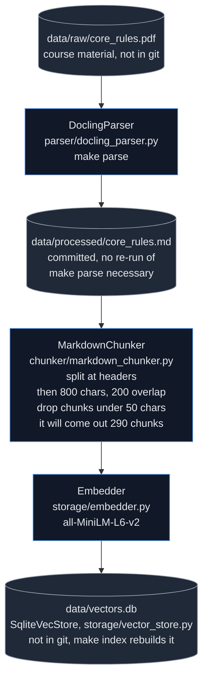
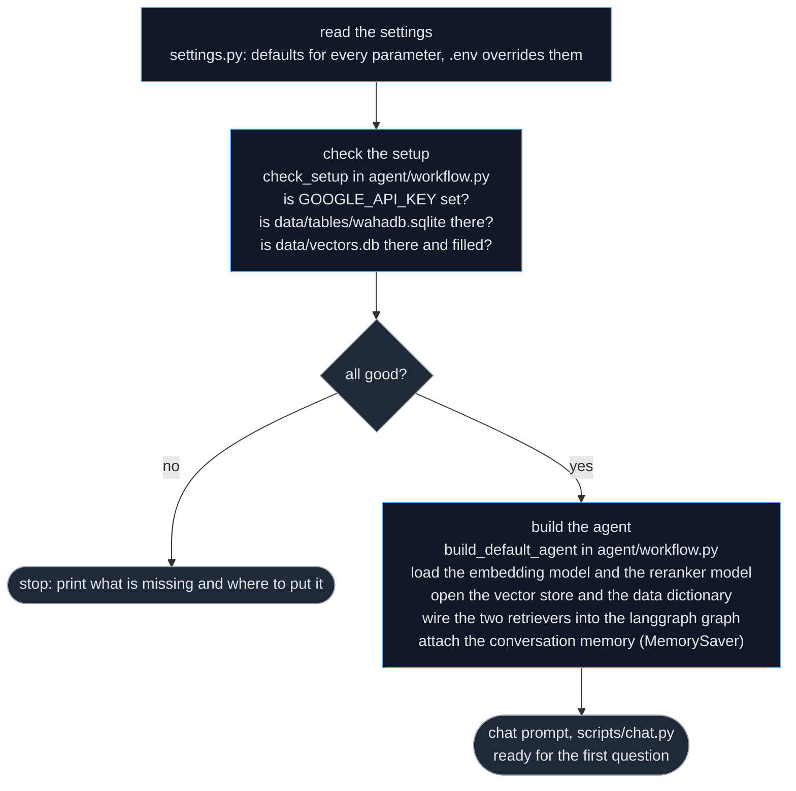
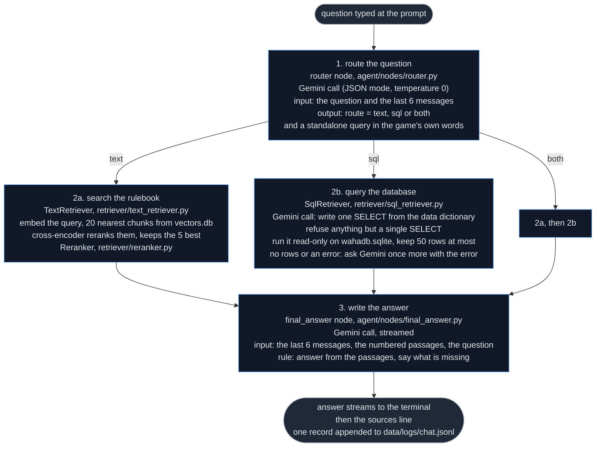
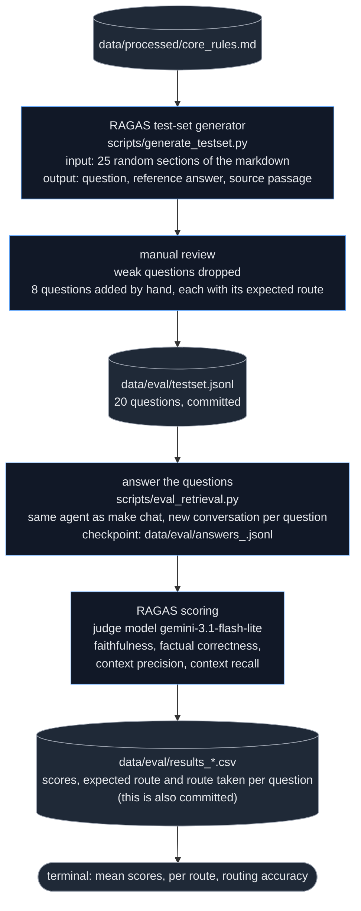

# Course project: Warhammer 40,000 chatbot

Authors: Nils KUJATH and Varvara SMIRNOVA

Course: Retrieval Augmented Generation (Year 2026/27)

## Quick start

Prerequisites: Python 3.11 or newer and [Poetry](https://python-poetry.org/) 2 (the lock file is in the Poetry 2 format).

Two files from the course material are not in git and have to be placed first:

| File | Put it at | Needed by |
|---|---|---|
| `wahadb.sqlite` (unit datasheets) | `data/tables/wahadb.sqlite` | `make chat`, `make ask-sql`, `make eval` |
| `core_rules.pdf` (Core Rules) | `data/raw/core_rules.pdf` | `make parse` only; the parsed rulebook `data/processed/core_rules.md` is committed, so this step is optional |

Then:

```bash
cp .env.example .env            # then paste your Google AI Studio key as GOOGLE_API_KEY
make install-dev                # install packages
make index                      # chunk + embed data/processed/core_rules.md -> data/vectors.db
make chat                       # talk to the agent
make test                       # run tests
make eval                       # RAGAS scores on the frozen test set in data/eval/ (slow)
```

The first `make index` and `make chat` download two small sentence-transformers
models (about 180 MB); a warning about an unset `HF_TOKEN` is expected and
harmless.

`make help` lists every command.


## Example session

In the following we will show an example session that assumes that the quickstart guide has been followed up until running `make chat`.
The chat has three commands: `/trace` toggles the trace lines, `/reset` starts a new conversation, `/quit` leaves (they come from `scripts/chat.py`).

We use the four questions the first slide deck of the course names. We ask the last question again after running `/reset` to show that the context is missing as to what it asks about the terminator, so the query is too broad and thus the query returns too much for the model to get a complete picture.

```bash
Warhammer 40k rules assistant
/reset new conversation   /trace toggle the trace   /quit quit

> What is the rule for grenades?
INFO     LLM gemini-3.5-flash-lite: 0.9s                                        
INFO     router: route=text query='What is the rule for grenades?'              
INFO     LLM gemini-3.5-flash-lite (stream): 5.3s                               
According to the rules, the Grenade rule is as follows:                         

▌ "WHEN: Your Shooting phase. TARGET: One Grenades unit from your army that is
▌ not within Engagement Range of any enemy units and has not been selected to 
▌ shoot this phase. EFFECT: Select one enemy unit that is not within          
▌ Engagement Range of any units from your army and is within 8" of and visible
▌ to your Grenades unit. Roll six D6: for each 4+, that enemy unit suffers 1  
▌ mortal wound."                                                              
sources: Rulebook

> /trace
trace off
> How can I use a stratagem?
According to the rules, command points can be spent to use Stratagems.          
Specifically:                                                                   

▌ "When you use a Stratagem, reduce your CP total by the amount listed on that
▌ Stratagem. If you do not have enough CP for a specific Stratagem, you cannot
▌ use it. You can use the same Stratagem multiple times during a battle, but  
▌ you cannot use the same Stratagem more than once in the same phase."        

Additionally, the rules state:                                                  

 • "To use a Stratagem you must pay the CP specified."                          
 • "The same Stratagem cannot be used more than once in the same phase."        
sources: Rulebook

> What are the different ways to score points?
Based on the provided rules, games of Warhammer 40,000 are won by:              

▌ "scoring more Victory points than your opponent through achieving various   
▌ objectives, from recovering vital relics to capturing enemy strongholds or  
▌ eliminating the opposing Warlord."                                          

Additionally, regarding progressive objectives such as Capture and Control,     
players score points as follows:                                                

▌ "Starting from the second battle round, at the end of each player's Command 
▌ phase, the player whose turn it is scores 1 Victory point (VP) for each     
▌ objective marker they control (to a maximum of 3VP per turn)."              
sources: Rulebook

> /trace
trace on
> What is the toughness of a space marine?
INFO     LLM gemini-3.5-flash-lite: 0.6s                                        
INFO     router: route=sql query='What is the Toughness of a Space Marine?'     
INFO     LLM gemini-3.5-flash-lite: 6.3s                                        
INFO     SQL: SELECT dm.t FROM datasheets d JOIN datasheets_models dm ON        
         dm.DatasheetId = d.Id WHERE d.name LIKE '%Space Marine%'               
INFO     LLM gemini-3.5-flash-lite (stream): 5.9s                               
Based on the provided game database, the toughness (t) of a Space Marine is 4.  
sources: Game database

> and a Terminator?
INFO     LLM gemini-3.5-flash-lite: 0.7s                                        
INFO     router: route=sql query='What is the toughness of a Terminator?'       
INFO     LLM gemini-3.5-flash-lite: 6.6s                                        
INFO     SQL: SELECT dm.t FROM datasheets d JOIN datasheets_models dm ON        
         dm.DatasheetId = d.Id WHERE d.name LIKE '%Terminator%'                 
INFO     LLM gemini-3.5-flash-lite (stream): 5.4s                               
Based on the provided game database, the toughness (t) of models with           
"Terminator" in their name typically ranges from 4 to 11, with 5 being the most 
common value.                                                                   
sources: Game database

> /reset
new conversation
> and a Terminator?
INFO     LLM gemini-3.5-flash-lite: 0.7s                                        
INFO     router: route=sql query='Terminator stats datasheets points weapons    
         abilities'                                                             
INFO     LLM gemini-3.5-flash-lite: 6.7s                                        
INFO     SQL: SELECT d.name AS datasheet_name, dm.name AS model_name, dm.m,     
         dm.t, dm.sv, dm.invSv, dm.invSvDescr, dm.w, dm.ld, dm.oc, dm.baseSize, 
         dm.baseSizeDescr, dmc.description AS cost_description, dmc.cost,       
         dw.name AS weapon_name, dw.range, dw.type AS weapon_type, dw.a AS      
         attacks, dw.bsWs, dw.s AS strength, dw.ap, dw.d AS damage, da.name AS  
         ability_name, da.description AS ability_description FROM datasheets d  
         JOIN datasheets_models dm ON dm.DatasheetId = d.Id LEFT JOIN           
         datasheets_models_cost dmc ON dmc.DatasheetId = d.Id LEFT JOIN         
         datasheets_wargear dw ON dw.DatasheetId = d.Id LEFT JOIN               
         datasheets_abilities da ON da.DatasheetId = d.Id WHERE d.name LIKE     
         '%Terminator%';                                                        
INFO     LLM gemini-3.5-flash-lite (stream): 5.4s                               
The provided database results are incomplete and do not cover the rules or stats
for a standard "Terminator" datasheet (only the first 50 rows are shown, which  
are restricted to the Shield-captain In Allarus Terminator Armour).             
sources: Game database

> /quit
```

## Architecture

### PDF to vector store 

This covers the commands `make parse` (PDF to markdown; optional, the output is committed because Docling takes quite long) and `make index` (markdown to vector store):



Docling takes some time, so we committed the result of running `make parse`. Two tables came out broken so we fixed them by hand (see limitations).
We split at the headers before splitting by length. This keeps a
rule inside one chunk and gives every chunk its section title.
`make index` takes about 20 seconds and rebuilds the store from scratch.

### Starting the chat

This covers `make chat` up to the prompt. The same checks from `check_setup` in `agent/workflow.py` run for `make ask-sql` and `make eval`.



Every parameter (models, K, chunk sizes, row caps, rate limit) is a field of one pydantic-settings class with a default, so a fresh clone runs with nothing but the key in `.env`. The check at start-up exists so that a missing file produces one line that says what to copy where.
The two sentence-transformers models are downloaded on the first run (about 180 MB) and cached afterwards; the Gemini client is built lazily on the first call, so importing the package never needs a key (so the tests run without providing a key in `.env` when run via `make test`).


### Answering a question

This explains what happens when we type a question in `make chat`.



The router rewrites the question into a standalone query from the conversation so far; that is what turns "and a Terminator?" into "What is the toughness of a Terminator?" (Example session above). Only the messages are kept between turns, the retrieved passages are not. The reranker is there because it measurably helps (context precision 0.20 to 0.32, see Evaluation). The database is opened read-only so nothing can be changed and only a single SELECT query is allowed. All Gemini calls go through `llm/gemini.py`, which throttles to 10 calls per minute and retries on quota errors.


### Evaluating the system

This covers `make gen-testset` (done once, the result is committed) and `make eval`.



The test set is frozen in git so that two runs can be compared; RAGAS generated the rulebook questions, we wrote the database ones by hand because RAGAS only reads text. The judge is a different Gemini model from the one that answers, as the course recommends. The output files carry the configuration in their name (`answers_gemini-3.5-flash-lite_k5_rerank20.jsonl`), so a changed setting never reuses old answers. The numbers are in the Evaluation section below.


## Evaluation

Run of 2026-10-28, answers by `gemini-3.5-flash-lite`, judge `gemini-3.1-flash-lite`, the 5 best of 20 retrieved passages (`data/eval/results_gemini-3.5-flash-lite_k5_rerank20.csv`):

| Metric | All 20 | Rulebook (15) | Database (4) | Both (1) |
|---|---|---|---|---|
| Faithfulness | 0.97 | 0.96 | 1.00 | 1.00 |
| Factual correctness (F1) | 0.62 | 0.66 | 0.47 | 0.63 |
| Context precision | 0.44 | 0.32 | 1.00 | 0.00 |
| Context recall | 0.85 | 0.80 | 1.00 | 1.00 |

Routing accuracy on the 8 labelled questions: 8/8. The factual correctness is lower than it should be, because the judge punishes wording (e.g.,the bolt-rifle answer got every number right but scored 0 since it uses the database's column names (A, BS/WS) where the reference answer uses the rulebook's words, "Attacks" and "Ballistic Skill").

Reranker on the 12 RAGAS questions (baseline `data/eval/results_gemini-3.5-flash-lite_k5_rerank0.csv`):

| Metric | without | with |
|---|---|---|
| Faithfulness | 0.94 | 0.95 |
| Factual correctness (F1) | 0.57 | 0.64 |
| Context precision | 0.20 | 0.32 |
| Context recall | 0.77 | 0.77 |

The reranked answers were judged three times on three days and stayed within 0.05, so the gain is above the judge's noise.

Monitoring. The trace in the chat shows route, rewritten query, SQL and the latency of every Gemini call (`/trace`). Every turn appends one JSON record (time, question, route, query, sources, SQL, seconds) to `data/logs/chat.jsonl`. With the free-tier model a rulebook turn takes about 7 seconds and a database turn about 13.


## Limitations

- Docling flattens every header of this rulebook to `##`, leaves 145 image placeholders, lost the dice values of the Wound-roll table and scrambled the contents page. The last two we fixed by hand in `core_rules.md`; a fresh `make parse` loses the fixes;
- `gemini-3.5-flash` answers better but allows 20 requests a day, so everything runs on flash-lite. One evaluation run takes about 45 minutes because of the rate limit;
- A follow-up without context ("and a Terminator?" right after `/reset`) gets a broad SQL query and a partial answer; asking the user back would be the fix;
- Keyword search (BM25) in addition to the vector search did not change the retrieved chunks for the four course questions, so we dropped it.

## Repository layout

Here is a quick overview to see what is where:

```
src/rag_chatbot/
  settings.py          all parameters (pydantic-settings)
  llm/                 Gemini client: generate(), stream(), rate limiter, retries
  parser/              DoclingParser
  chunker/             MarkdownChunker, Chunk
  storage/             Embedder, SqliteVecStore
  retriever/           TextRetriever, Reranker, SqlRetriever
  agent/               langgraph graph, nodes (router, retrieve, final_answer), check_setup
  evaluate/            RAGAS adapters
scripts/               parse, index, chat, ask_sql, generate_testset, eval_retrieval
tests/                 unit tests
data/processed/        parsed rulebook (committed)
data/eval/             test set and results (committed)
```

## Tests

`make test` runs 57 unit tests. They need no network and no API key, the LLM is replaced by a fake, the SQL tests use a small SQLite database created on the fly, and the vector store test runs on sqlite-vec itself. The tests were largely written with a coding agent and reviewed by us. `make lint` runs ruff, and the pre-commit hook runs the same check on every commit.
